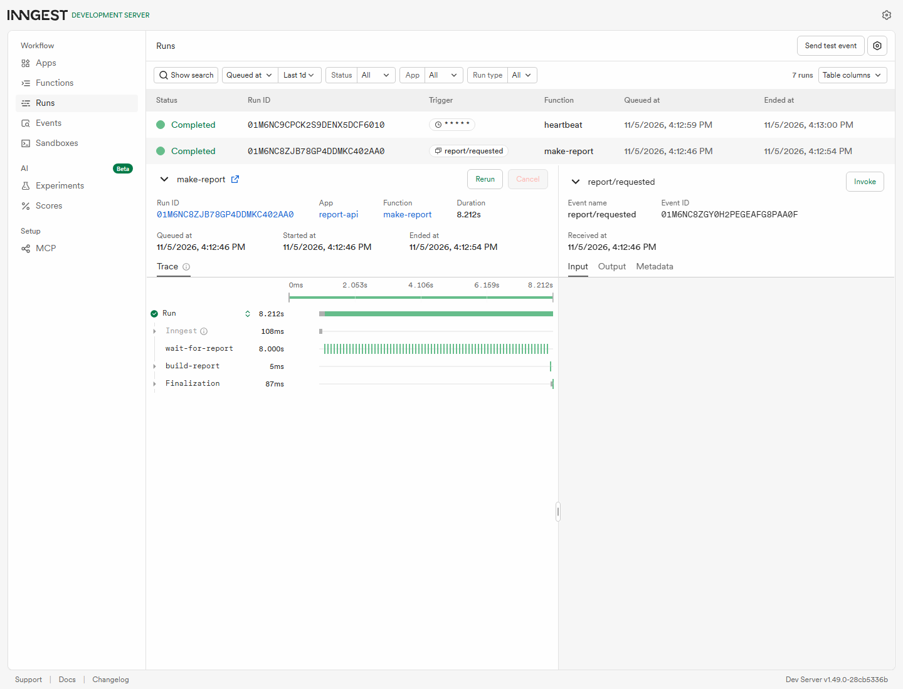
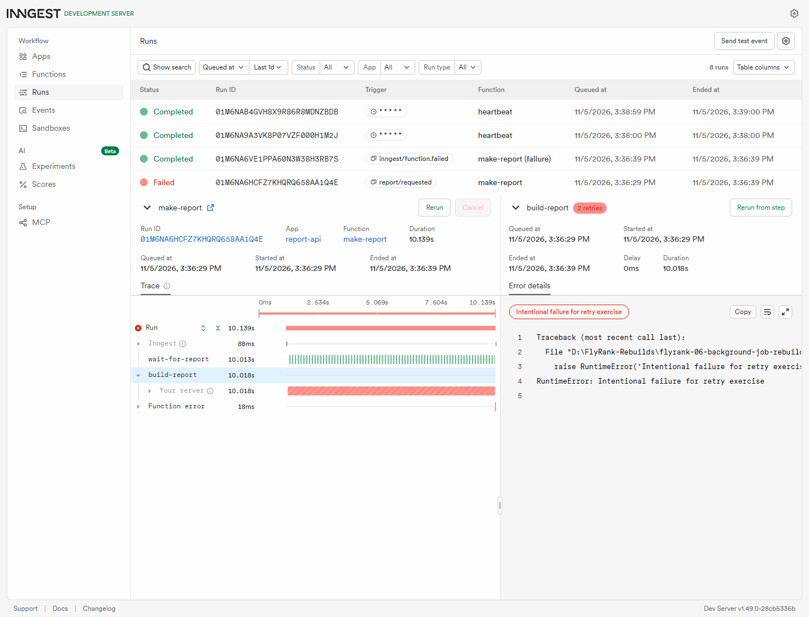
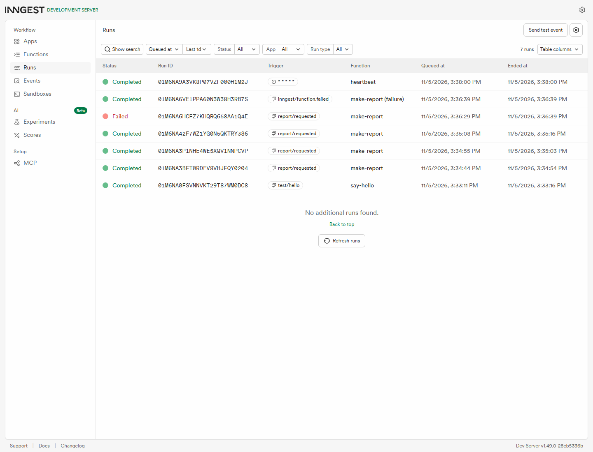

# Background report jobs

Rebuilt on 2026-11-05 from the prior assignment implementation with fresh stage checkpoints. AI-assisted rebuild; no claim of original hand-written work or historical stage dates. The public repository was created before implementation.

Install Python 3.12+ and Node.js, then run `pip install -r requirements.txt` in this directory. Start the API:

```sh
python -m uvicorn app:app --port 8106
```

In a second terminal, start the free Inngest development server:

```sh
npx inngest-cli@latest dev --port 8386 --no-discovery -u http://127.0.0.1:8106/api/inngest --retry-interval 1
```

Open http://127.0.0.1:8386 for the dashboard. Both processes must remain running. Numeric loopback URLs avoid a Windows localhost-resolution delay observed during the clean-server check. No account, key or credit card is required for the local development server.

| Method | Endpoint | Result |
|---|---|---|
| GET | /health | 200 health JSON |
| POST | /reports | 202 with pending report id for `{"topic":"cats"}` |
| GET | /reports/{id} | 200 pending, then done/result or failed/error; 404 unknown id |

Missing, blank or nonstring topics return400. If Inngest cannot accept the event, the API returns503 and removes the phantom pending report.

| Function | Trigger | Work |
|---|---|---|
| say-hello | test/hello | 5-second durable sleep, then greeting |
| make-report | report/requested | 8-second sleep, then build-report step |
| heartbeat | `* * * * *` | Every minute, log pending/done/failed counts |

## Actual 202 and polling evidence

The fresh rebuild returned202 in0.021seconds, then pending immediately and done after10seconds:

```json
{"id":"cc8ef43f-26fd-4cda-919f-803aa464752d","status":"pending"}
{"id":"cc8ef43f-26fd-4cda-919f-803aa464752d","status":"done","result":"Report about cats"}
```

See [report-proof.json](report-proof.json) and [BUILDLOG.md](BUILDLOG.md) for measured timings and real output. A later cold SDK request using localhost took2.714seconds; after changing the SDK URL to numeric127.0.0.1, the first submission after an API restart returned202 in0.009seconds. This setup fix is included in the final implementation.

For your own check, POST `{"topic":"cats"}` to `/reports`, copy the id, and GET `/reports/{id}` immediately and again after8–10seconds. The API acknowledges queued work before a worker finishes it—eventual consistency means a later read can contain a result that an earlier read did not yet have.

## Retry and cron proof

POSTing `{"topic":"fail"}` produced attempts1,2,3, then a Failed run and an API failed status. The SDK setting `retries=2` means one initial attempt plus two retries. [retry-proof.json](retry-proof.json) includes all three actual BUILD lines and the final-failure line. These builds have no external side effects; real email or payment jobs need idempotency because a retried job can otherwise perform an action twice.

The every-minute cron produced real ticks at07:39:00.027471UTC and07:40:00.032986UTC, 60.005515seconds apart; [heartbeat-proof.json](heartbeat-proof.json) records them. `0 8 * * *` means daily08:00UTC; `0 22 * * 0` means Sunday22:00UTC.





## Tests and limitations

Run `python -m pytest -q`: four tests pass, covering validation, queuing/status, exhausted failure exposure, and queue-outage cleanup. The installed Inngest SDK emits a Pydantic deprecation warning; it did not affect the checks.

The report status map intentionally lives in API memory for this assignment and resets when the API restarts. The local Inngest dev server is for development. This is an openly documented AI-assisted reconstruction using current dates, with real stage checkpoints and no claim of original hand-written development. Optional extras and the optional AI rematch were not added.
